### ♡ Poketter

> **mirocoAM** ✧ `@mirocoAM` · DAY 1
>
> hiii P-chan!! i make things on the internet (｡•̀ᴗ-)✧
> right now: a dual-screen **Nintendo 3DS port** of NEEDY GIRL OVERDOSE,
> written in **C + Lua**, plus **Discord bots** and little **websites** ♡
> if my code makes you happy, a ⭐ is my favourite medicine
>
> 🔁 99 &nbsp;&nbsp; ♡ 1,000,000 &nbsp;&nbsp; 💬 0

### 📡 Stream schedule

| | stream | what happens |
|:-:|---|---|
| 🎮 | **NEEDY GIRL OVERDOSE 3DS** *(private, coming soon)* | Windose on two screens: Ame's webcam on top, the touch desktop below. C engine + Lua, ES / EN / JA |
| 🤖 | **SCENE-BOT** *(private)* | all-in-one Discord bot controlled by AI — music, TTS, levels, moderation… written in Rust |
| 🌐 | [**LODORUM-front**](https://github.com/mirocoAM/LODORUM-front) | web front-end |
| 💌 | [**MirocHey**](https://github.com/mirocoAM/MirocHey) | a little web page |
| 🤖 | [**rei-bot**](https://github.com/mirocoAM/rei-bot) · [**TURBO-BOT-V3**](https://github.com/mirocoAM/TURBO-BOT-V3) | the first bots, where it all began |

🔒 <b>ura account</b> (do not open)

 

> **uramirocoAM** · 3:47 AM
>
> the build failed again.
> it's fine. it's fine. it's fine.
> one more commit and then i'll sleep. (i will not sleep.)

♡ fan-made profile · NEEDY GIRL OVERDOSE characters, sprites and fonts © WSS playground / xemono · not affiliated with the developers ♡

